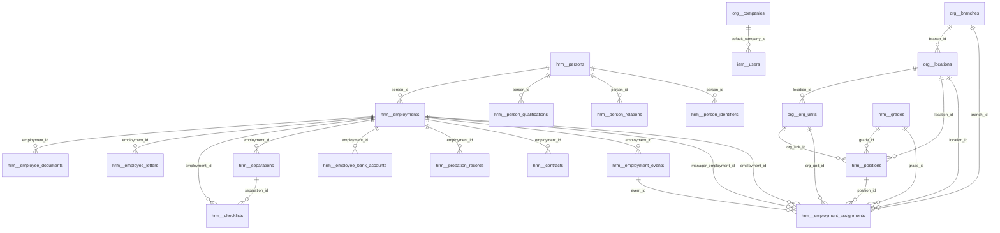
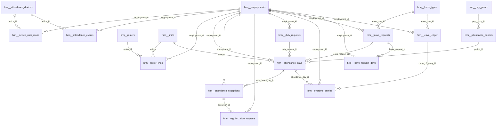
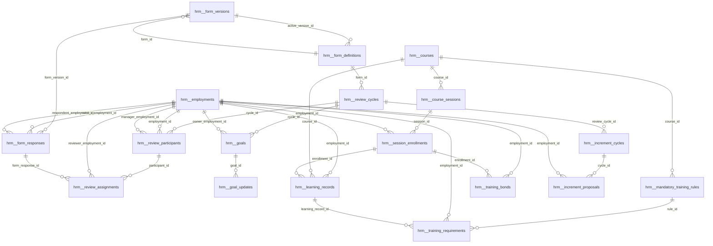
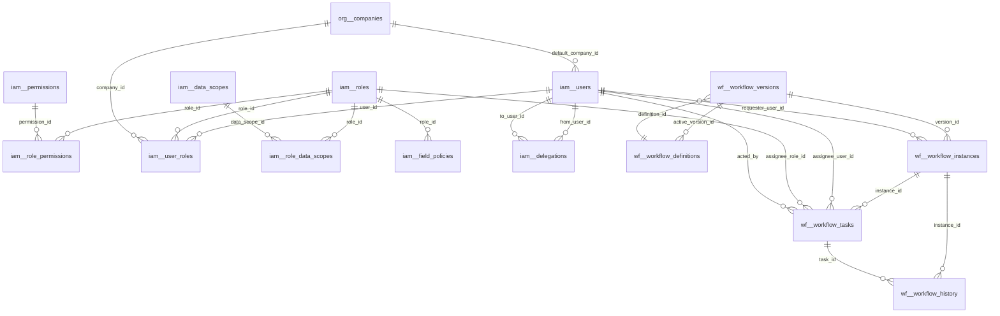

# Entity relationship diagrams (Release 1.0)

Generated from the YAML files. Each box is a table; each line is a reference from one table to another. GitHub shows these as pictures.

## People, employment and structure

## Attendance and leave

## Payroll and settlement

```mermaid
erDiagram
  hrm__pay_groups ||--o{ hrm__pay_periods : "pay_group_id"
  hrm__salary_structures ||--o{ hrm__salary_structure_components : "structure_id"
  hrm__pay_components ||--o{ hrm__salary_structure_components : "component_id"
  hrm__employments ||--o{ hrm__compensation_assignments : "employment_id"
  hrm__salary_structures ||--o{ hrm__compensation_assignments : "structure_id"
  hrm__compensation_assignments ||--o{ hrm__compensation_lines : "assignment_id"
  hrm__pay_components ||--o{ hrm__compensation_lines : "component_id"
  hrm__statutory_tables ||--o{ hrm__statutory_table_rows : "table_id"
  hrm__pay_groups ||--o{ hrm__pay_runs : "pay_group_id"
  hrm__pay_periods ||--o{ hrm__pay_runs : "pay_period_id"
  hrm__pay_runs ||--o{ hrm__pay_run_employees : "pay_run_id"
  hrm__employments ||--o{ hrm__pay_run_employees : "employment_id"
  hrm__employments ||--o{ hrm__pay_inputs : "employment_id"
  hrm__pay_periods ||--o{ hrm__pay_inputs : "pay_period_id"
  hrm__pay_components ||--o{ hrm__pay_inputs : "component_id"
  hrm__pay_runs ||--o{ hrm__pay_inputs : "consumed_by_run_id"
  hrm__pay_runs ||--o{ hrm__pay_results : "pay_run_id"
  hrm__employments ||--o{ hrm__pay_results : "employment_id"
  hrm__pay_results ||--o{ hrm__pay_result_lines : "result_id"
  hrm__pay_components ||--o{ hrm__pay_result_lines : "component_id"
  hrm__pay_results ||--o{ hrm__pay_traces : "result_id"
  hrm__employments ||--o{ hrm__retro_adjustments : "employment_id"
  hrm__pay_runs ||--o{ hrm__retro_adjustments : "original_run_id"
  hrm__pay_components ||--o{ hrm__retro_adjustments : "component_id"
  hrm__pay_runs ||--o{ hrm__retro_adjustments : "applied_in_run_id"
  hrm__pay_runs ||--o{ hrm__payment_batches : "pay_run_id"
  hrm__payment_batches ||--o{ hrm__payment_lines : "batch_id"
  hrm__pay_results ||--o{ hrm__payment_lines : "result_id"
  hrm__employments ||--o{ hrm__final_settlements : "employment_id"
  hrm__pay_runs ||--o{ hrm__final_settlements : "pay_run_id"
  hrm__final_settlements ||--o{ hrm__final_settlement_lines : "settlement_id"
  hrm__pay_components ||--o{ hrm__final_settlement_lines : "component_id"
  hrm__employments ||--o{ hrm__loans : "employment_id"
  hrm__pay_periods ||--o{ hrm__loans : "start_period_id"
  hrm__employments ||--o{ hrm__loans : "guarantor_employment_id"
  hrm__loans ||--o{ hrm__loan_installments : "loan_id"
  hrm__pay_periods ||--o{ hrm__loan_installments : "pay_period_id"
  hrm__pay_result_lines ||--o{ hrm__loan_installments : "pay_result_line_id"
  hrm__loans ||--o{ hrm__loan_transactions : "loan_id"
  hrm__employments ||--o{ hrm__expense_claims : "employment_id"
  hrm__pay_inputs ||--o{ hrm__expense_claims : "pay_input_id"
  hrm__employments ||--o{ hrm__liability_accruals : "employment_id"
  hrm__pay_periods ||--o{ hrm__liability_accruals : "pay_period_id"
  itg__accounting_events ||--o{ hrm__liability_accruals : "accounting_event_id"
  hrm__pay_groups ||--o{ hrm__attendance_periods : "pay_group_id"
  hrm__pay_runs ||--o{ hrm__attendance_periods : "locked_by_run_id"
```

## Performance and learning

## Identity, access and workflow (kernel)

